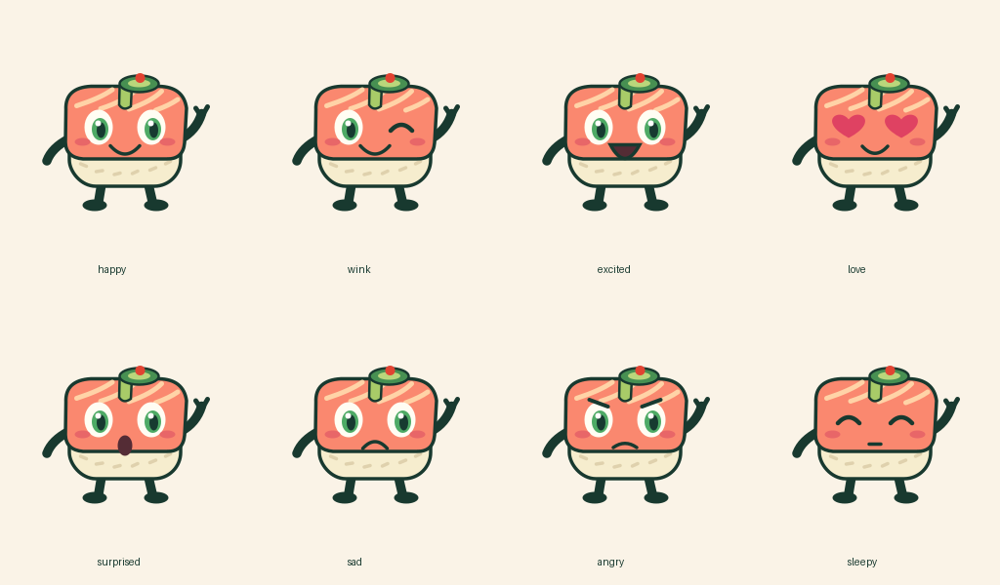

# Suki the Sexy Salmon — mascot production kit

Suki is a salmon nigiri character for Aquinos Sushi Bar: green eyes, black nori limbs, a short avocado fringe, jalapeño slice and one red hot-sauce dot. No lower-body green band.



## Ready-to-use assets

- **Eight expressions:** happy, wink, excited, love, surprised, sad, angry and sleepy.
- `assets/2d/`: layered, editable SVGs and 1080 × 1080 transparent PNGs for menus and graphics.
- `assets/3d/`: eight animated GLB models, transparent 1080px renders and an editable `suki-happy.blend` scene. Models have named parts, materials and animated object controls for bobbing and waving. Expressions are separate models, not facial blend shapes or a skinned skeleton.
- `assets/social/`: idle, wave and dance loops as transparent animated WebP, transparent sprite sheets, and H.264 MP4 in square (1080 × 1080) and portrait (1080 × 1920) formats. MP4s have a cream background. Each loop is 48 frames at 24fps (2 seconds); WebP rounds timing to 42ms/frame.
- `preview.html`: local gallery with asset download links.

## Run in Visual Studio Code

Install **Python 3.11+**, **Blender 4.3+**, and **FFmpeg** with H.264 encoding. Make `python`, `blender` and `ffmpeg` available on PATH. On Windows enable “Add Python to PATH”; Blender and FFmpeg may need their installation folders added manually. VS Code edits and launches the code; Blender performs 3D generation.

Open this repository folder in VS Code. In its terminal:

```sh
python -m venv .venv
```

Activate with `source .venv/bin/activate` (macOS/Linux), or `.venv\Scripts\Activate.ps1` (Windows PowerShell). Select that interpreter in VS Code, then:

```sh
python -m pip install -r requirements.txt
python tools/export_2d.py --video
blender --background --python 3d-blender/export_suki.py -- --render
python -m http.server 8000
```

Open http://localhost:8000/preview.html. Use **Terminal → Run Task** for the included export and preview tasks. If Blender is not on PATH, replace `blender` with its full executable path in `.vscode/tasks.json`.

CairoSVG requires the native Cairo library. On macOS: `brew install cairo`; on Debian/Ubuntu: `sudo apt install libcairo2`; on Windows install Cairo following [CairoSVG's installation guide](https://cairosvg.org/documentation/). FFmpeg is needed only with `--video`; omit that flag for PNG/SVG/WebP exports.

## Customize and animate

Edit colors, shapes and expressions in `tools/export_2d.py` and `3d-blender/export_suki.py`. SVG groups are named `nori-limbs`, `rice`, `salmon`, `garnish` and `face`; edit them in Inkscape, Illustrator or a text editor. Blender objects are named by character part. Edit `Suki_root` and `Wave_pivot` keyframes in Blender's Dope Sheet. GLB files carry the bob and wave animations; imported animation clip handling depends on the destination app.

Export one expression, or a transparent 3D PNG sequence:

```sh
blender --background --python 3d-blender/export_suki.py -- --expression wink --render
blender --background --python 3d-blender/export_suki.py -- --expression happy --animation
```

The generator clears the current Blender scene. Run it in background as shown, or in a new empty Blender document. Outputs overwrite matching files under `assets/`; keep custom work elsewhere. `--animation` renders 48 frames per selected expression and can take several minutes. For social video, composite the sequence over your preferred background in a video editor. SVG is the best menu/print source; PNG/WebP preserve alpha, MP4 does not. Keep graphics inside each platform's current safe area when adding captions.

The original `2d-godot/` prototype and `3d-blender/suki_blockout.py` remain available as development references. The production kit above runs independently of Godot/.NET.

## Verification

```sh
python tools/validate_assets.py
```

GitHub Actions also runs this validation on pushes and pull requests. This validates expression coverage, transparent image dimensions, animation frames, GLB headers and embedded animation channels, and social video resolution/frame counts using FFprobe.

## Rights

Existing Aquinos branding and reference-art rights remain with their respective owners. This repository does not grant third-party branding rights.
